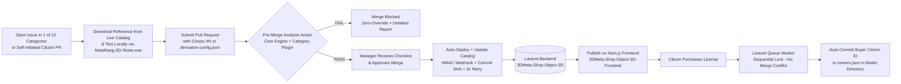
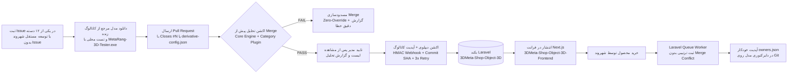

<div align="center">

# 🌐 Model3d-Metaverse-Rang | مخزن مرکزی مدل‌های سه‌بعدی متاورس رنگ

**Official GitOps Infrastructure, 12-Category Plugin Architecture, Issue-Driven Automated Testing & 3DMeta-Shop Integration for MetaRang & Ariana Island**

[](https://metarang.com)
[-dc2626?style=for-the-badge)](./LICENSE)
[](#-9-zero-override-main-lock--repository-governance)
[](#-4-plugin-based-architecture--12-specialized-categories)
[-0284c7?style=for-the-badge)](./.gitattributes)
[](https://github.com/iranpsc/3DMeta-Shop-Object-3D)

### 🌍 Language / انتخاب زبان
**[🇬🇧 English Documentation](#-english-documentation)** &nbsp;|&nbsp; **[🇮🇷 مستندات فارسی](#-مستندات-فارسی)**

</div>

---

<a id="-english-documentation"></a>
<div dir="ltr">

# 🇬🇧 English Documentation (`MR-3D-EXEC-V5.0`)

> [!IMPORTANT]
> **Dual-License Policy (Public Repository + Exclusive Commercial Protection):**
> This repository is maintained as **Public** so 3D artists, developers, and trainees can download, inspect, fork, and contribute models via Pull Requests (**under `CC BY-NC-SA 4.0` — Non-Commercial Use Only**).
> Any **commercial or operational deployment** is strictly permitted only after purchasing a license through **3DMeta-Shop** (`3DMeta-Shop-Object-3D`) and having the buyer's Citizen ID recorded in the platform database and the model's `owners.json` file.

> [!CAUTION]
> **Integrity Clause + Absolute `main` Branch Lock (`Zero-Override`):**
> 1. Any malicious usage, publishing corrupted derivatives under the MetaRang brand, or actions that undermine the credibility of a model, its Primary Owner (e.g., `BN-1000`), or MetaRang infrastructure constitutes a direct license violation.
> 2. **`enforce_admins: true` (Zero-Override)** is enforced on `main`; no user—including repository administrators—can override or merge a Pull Request with failing automated analysis checks.

## 📑 Table of Contents

- [1. Vision & Five Pillars of Sustainability](#-1-vision--five-pillars-of-sustainability)
- [2. Ecosystem Architecture & Two-Way Automation](#-2-ecosystem-architecture--two-way-automation)
- [3. Central Directory Structure (5 Ownership + 3 System Layers)](#-3-central-directory-structure-5-ownership--3-system-layers)
- [4. Plugin-Based Architecture & 12 Specialized Categories](#-4-plugin-based-architecture--12-specialized-categories)
- [5. Specialized Standards: Avatars (RPM) & Vehicles (Unity 6)](#-5-specialized-standards-avatars-rpm--vehicles-unity-6)
- [6. Dual-Track Development & Versioning (Issue-Backed vs. Self-Initiated)](#-6-dual-track-development--versioning-issue-backed-vs-self-initiated)
- [7. Live `main` Catalog, Issue Auto-Linker Bot & Local Tester](#-7-live-main-catalog-issue-auto-linker-bot--local-tester)
- [8. Core Engine Testing Contract & Standard JSON Schemas](#-8-core-engine-testing-contract--standard-json-schemas)
- [9. Zero-Override `main` Lock & Repository Governance](#-9-zero-override-main-lock--repository-governance)
- [10. Implementation Roadmap (7 Phases - V5.0)](#-10-implementation-roadmap-7-phases---v50)

---

## 🎯 1. Vision & Five Pillars of Sustainability

Built on executive specification **`MR-3D-EXEC-V5.0`**, **`Model3d-Metaverse-Rang`** serves as the automated production, technical auditing, versioning, and deployment backbone for 3D assets across **MetaRang** and **Ariana Island**, sustaining five core pillars with zero human error:

| Strategic Pillar | Operational Mechanism in V5.0 |
| :--- | :--- |
| **1. 3D Order Fulfillment** | Structured organizational, investor (e.g., Matrix Exit Fund `BN-1000`), and urban orders submitted via **12 specialized Issue Forms** with machine-readable test contracts. |
| **2. Precision 3D Marketplace (`3DMeta-Shop`)** | Exclusive commercial licensing via **Laravel API** and **Next.js**, supporting **independent citizen pricing** for self-initiated derivatives and reverse sync to `owners.json`. |
| **3. Training & Development Workshops** | Open public repository for real-world portfolio building; GitHub accounts and social links from the MetaRang **"About Me"** profile (via **Golang** microservice) auto-bind to Citizen IDs. |
| **4. 3D Data Analytics Hub** | Automated generation of `product-detail.json` capturing real-world dimensions (meters), footprint, polygons, vertices, textures, animations, `HEX` color palettes, RPM rigs, and vehicle meshes. |
| **5. Plugin-Based Automation (GitOps)** | Single Source of Truth analyzer powering both CI and **`MetaRang-3D-Tester.exe`**, `Zero-Override` protection, live catalog, Issue Auto-Linker bot, and queued `owners.json` sync. |

---

## 🔄 2. Ecosystem Architecture & Two-Way Automation



### Connected Ecosystem & Tech Stack

| Component | Tech Stack | Repository / URL | Role |
| :--- | :--- | :--- | :--- |
| **Central 3D Model Repository** | Git LFS + Python Plugins + GitHub Actions | [`iranpsc/Model3d-Metaverse-Rang`](https://github.com/iranpsc/Model3d-Metaverse-Rang) | Asset storage, plugin validation, live catalog, `product-detail.json`, and `owners.json` |
| **3DMeta-Shop Backend** | **Laravel API** + Queue Worker | [`iranpsc/3DMeta-Shop-Object-3D`](https://github.com/iranpsc/3DMeta-Shop-Object-3D) | Signed Webhook receiver, DB & analytics filters, pricing, orders, and queued `owners.json` sync |
| **3DMeta-Shop Frontend** | **Next.js** | [`iranpsc/3DMeta-Shop-Object-3D-Frontend`](https://github.com/iranpsc/3DMeta-Shop-Object-3D-Frontend) | 12-category storefront, generated details, technical filters, and checkout |
| **Citizen Identity Service ("About Me")** | **Golang Microservice** (with Fallback Adapter) | `metarang.com` / `world.metarang.com` | Tamper-proof mapping of GitHub account & social links to **Citizen ID** |

---

## 🗂️ 3. Central Directory Structure (5 Ownership + 3 System Layers)

The owner directory name (e.g., `BN-1000` for **Matrix Exit Fund**) designates the **Primary Owner**, and all files for each release are consolidated inside a versioned `v<N>` directory (`v1`, `v2`, ...):

```text
Model3d-Metaverse-Rang/
├── 01-investors-assets/                 # Investor & MetaRang investment assets
│   └── BN-1000/                         # Primary Owner ID (Matrix Exit Fund)
│       ├── lighthouse/                  # Ariana Island Lighthouse
│       │   ├── v1/                      # All files for Version 1
│       │   │   ├── lighthouse.gltf      # or .glb (Git LFS - Max 100MB per package)
│       │   │   ├── lighthouse.bin
│       │   │   ├── textures/            # PBR textures (4K / KTX2 / PNG)
│       │   │   ├── renders/             # Minimum 2 renders for color & detail generation
│       │   │   ├── product-detail.json  # Auto-generated metadata for Webhook deploy
│       │   │   └── owners.json          # Auto-updated buyer Citizen IDs after purchase
│       │   └── v2/                      # Official Issue-backed upgrade
│       ├── beach-club/v1/               # Ariana Island Beach Club
│       ├── exchange/v1/                 # Ariana Island Exchange
│       ├── diving-station/v1/           # Ariana Island Diving Station
│       ├── surfing-station/v1/          # Ariana Island Surfing Station
│       └── teleport-gate/v1/            # Ariana Island Teleport Gate
├── 02-companies-holdings/               # Independent companies & holdings (<HOLDING-ID>/<slug>/v1/)
├── 03-citizen-creations/                # Independent citizen creations (<HM-CITIZEN-ID>/<slug>/v1/)
├── 04-metarang-core-assets/             # Core MetaRang platform assets (<category>/<slug>/v1/)
├── 05-forked-developments/              # Self-initiated citizen derivatives (<HM-ID>/<custom-name>/<custom-variant>/)
├── catalog/                             # [System] Live searchable catalog of main branch models
│   ├── CATALOG.md                       # Searchable table with direct links
│   └── catalog.json                     # Lightweight index for bots & desktop tester
├── schemas/                             # [System] Central registry for 12 categories
│   └── category-registry.json           # Single point to add future categories without core edits
├── scripts/
│   ├── analyze_3d_model.py              # Shared Core Engine analyzer
│   └── validators/                      # 12 specialized validator plugins (building.py, avatar.py, vehicle.py, ...)
├── tools/
│   └── metarang_3d_tester_gui.py        # Source for standalone MetaRang-3D-Tester.exe
└── .github/
    ├── ISSUE_TEMPLATE/                  # 12 specialized Issue Forms + config.yml
    ├── PULL_REQUEST_TEMPLATE.md         # Dual-track PR template
    └── workflows/                       # pre-merge-analysis, issue-auto-linker, update-catalog, auto-deploy, build-exe
```

---

## 🧩 4. Plugin-Based Architecture & 12 Specialized Categories

To guarantee long-term scalability, validation is split into a **Core Engine** (common to all models) and **12 Specialized Plugins** dynamically loaded via `schemas/category-registry.json` and Issue labels (`type:<category>`). Each category has a single unified Issue Form containing an operation dropdown (`New Creation` / `Official Upgrade v2` / `Fork & Divergent Development`):

| Category Code (`asset_type`) | Issue Form Title | Key Examples in MetaRang | Plugin-Specific Automated Checks |
| :--- | :--- | :--- | :--- |
| **`building`** | 🏗️ Architecture & Buildings | Towers, villas, lighthouse, beach club, exchange, halls | Footprint & dimensions (`±2%`), ground alignment (`Y=0`), `Interior`, night `Emissive`, Colliders |
| **`avatar`** | 🧑 Avatars & Humanoid Characters | Citizen avatars, VIP characters, NPCs, mascots (JELLY) | **Ready Player Me (RPM)** compatibility, **mandatory Blendshapes**, standard Humanoid rig & skeleton |
| **`vehicle`** | 🚗 Vehicles (Land, Air, Sea) | Cars, buses, 2W/4W motorcycles, helicopters, airplanes, jetpacks, balloons, boats, tourist ships | Standardized movable mesh naming for **Unity 6**, `+Z` forward axis, driver/pilot seats, lights |
| **`wearable`** | 👕 Wearables & Accessories | Clothing, hats, glasses, bags, jewelry, citizen NFTs | **RPM** skeleton alignment, `Attachment Anchor`, skinning weights |
| **`urban-prop`** | 🪑 Urban Furniture & Props | Benches, streetlamps, signs, bike stations, footbridges | Lightweight polygon budget, `LOD` support, ground-level pivot |
| **`interior-decor`** | 🛋️ Interior Decor & Furniture | Office/residential furniture, retail & gallery fixtures | Ergonomic human scale (meters), PBR materials, clean UVs |
| **`foliage-nature`** | 🌿 Foliage & Natural Elements | Ariana Island palm trees, shrubs, flowers, rocks | Alpha/Cutout leaf optimization, Draw Call budget, `LOD` levels |
| **`tech-gadget`** | 📱 Tech Gadgets & Robots | Phones, holographic panels, teleport gates, kiosks, drones | `Screen_Mesh` attachment points, `Emissive` displays, interactive animations |
| **`art-sculpture`** | 🗿 Art, Sculptures & NFTs | Urban sculptures, art frames, iconic collectibles | High-fidelity geometry & 4K/KTX2 textures, standard mounting base |
| **`modular-kit`** | 🧩 Modular Kits & Snapping Pieces | Walls, roofs, road segments, docks | Strict `Grid Snapping` (`1m`/`2m`/`4m`), seamless edge alignment |
| **`animation-pack`** | 🎬 Avatar Animation Packs | Quick-access emotes, dances, social interactions | Full **RPM/Mixamo** rig compatibility, clip format, `Loop` & `Root Motion` |
| **`environment-vfx`** | ✨ Environment, Lighting & VFX | Waterfalls, fountains, skyboxes, atmospheric elements | Shader/Emissive checks, texture budget, WebGL/VR FPS compliance |

---

## 🔬 5. Specialized Standards: Avatars (RPM) & Vehicles (Unity 6)

### 5.1. Mandatory Avatar Validation (`scripts/validators/avatar.py`)
* **Ready Player Me (RPM) Rig & Skeleton:** Presence of `skins` in `glTF`/`GLB` is mandatory. Key Humanoid bones (`Hips`, `Spine`, `Spine1`, `Spine2`, `Neck`, `Head`, `Left/Right Shoulder, Arm, ForeArm, Hand`, and `Left/Right UpLeg, Leg, Foot`) are automatically validated.
* **Mandatory Blendshapes (Morph Targets):** The head mesh (`Wolf3D_Head` or `Head`) must include `targets` covering **Oculus Visemes** (for in-world Lip-Sync such as `viseme_aa`, `viseme_O`, `viseme_sil`) and **ARKit Blendshapes**. Missing Blendshapes results in an immediate **`FAIL`**.
* **Skinning & Optimization:** Verifies `JOINTS_0` and `WEIGHTS_0` attributes on all skinned meshes and enforces bone count limits for WebGL and Meta Quest 3.

### 5.2. 10 Vehicle Subtypes for Unity 6 (`scripts/validators/vehicle.py`)
Based on the selected **`Vehicle Subtype`** in the Issue Form, the validator verifies separated mesh/node naming for plug-and-play Unity 6 physics:

| Vehicle Subtype | Mandatory Meshes / Nodes in `glTF`/`GLB` | Unity 6 Shared Standard |
| :--- | :--- | :--- |
| **Passenger Car (`car`)** | `Body`, `Wheel_FL`, `Wheel_FR`, `Wheel_RL`, `Wheel_RR`, `Door_FL`, `Door_FR`, `SteeringWheel`, `Seat_Driver` | Forward `+Z`, wheels resting on `Y=0`, `Emissive` head/brake lights |
| **Bus (`bus`)** | `Body`, `Wheel_FL`, `Wheel_FR`, `Wheel_RL`, `Wheel_RR` (+ extra axles), `Door_Front`, `Door_Mid`, `Seat_Driver` | Separated passenger cabin & door colliders |
| **2-Wheel Motorcycle (`motorcycle_2w`)** | `Body`, `Wheel_F`, `Wheel_R`, `Handlebar`, `Seat_Driver` | Handlebar pivot aligned to front fork steering axis |
| **4-Wheel ATV (`atv_4w`)** | `Body`, `Wheel_FL`, `Wheel_FR`, `Wheel_RL`, `Wheel_RR`, `Handlebar`, `Seat_Driver` | All 4 wheels separated for `WheelCollider` |
| **Helicopter (`helicopter`)** | `Body`, `Rotor_Main`, `Rotor_Tail`, `Skids` / `LandingGear`, `Seat_Pilot` | Main & tail rotor pivots centered on rotation axes |
| **Airplane (`airplane`)** | `Body`, `Propeller` or `Turbine_L/R`, `LandingGear_F/L/R`, `Aileron_L/R`, `Rudder`, `Seat_Pilot` | Forward `+Z` with separated control surfaces |
| **Jetpack (`jetpack`)** | `Body`, `Thruster_L`, `Thruster_R`, `Mount_Spine` | Mount point aligned to RPM `Spine2` bone |
| **Hot Air Balloon (`hot_air_balloon`)** | `Envelope`, `Basket`, `Burner` | Low center of mass on basket; separated burner for flame VFX |
| **Boat (`boat`)** | `Hull`, `Propeller` / `Engine`, `Rudder`, `Helm`, `Seat_Driver` | Waterline aligned to `Y=0` |
| **Tourist Ship (`tourist_ship`)** | `Hull`, `Deck_Main`, `Propeller_L/R`, `Rudder`, `Bridge`, `Boarding_Zone` | Separated decks and walkable corridor colliders for avatars |

---

## 🔀 6. Dual-Track Development & Versioning (Issue-Backed vs. Self-Initiated)

| Attribute | Track 1: Official Issue-Backed (`Issue-Backed`) | Track 2: Self-Initiated Citizen Derivative (`Self-Initiated`) |
| :--- | :--- | :--- |
| **Trigger** | Linked to an official Issue via `Closes #N` in PR | No Issue required; citizen downloads, customizes, and submits a PR |
| **Directory & Naming** | Sequential version under Primary Owner: `BN-1000/lighthouse/v2/` | Custom directory & variant name under fork branch: `05-forked-developments/<HM-ID>/<custom-name>/<custom-variant>/` |
| **Pricing & Ownership** | Owned by Primary Owner (`BN-1000`); priced by owner/admin | Creator includes `derivative-config.json` with `custom_pricing`, `asset_type`, and `parent_model_ref` |
| **Validation & Merge Gate** | Core Engine + Category Plugin + Issue Contract (`±2%` dims, `HEX` colors) + `Zero-Override` | Core Engine + Category Plugin (RPM / Unity 6 Vehicle, etc.) + `parent_model_ref` & pricing check + `Zero-Override` |

---

## 🔎 7. Live `main` Catalog, Issue Auto-Linker Bot & Local Tester

* **Live Searchable Catalog (`catalog/CATALOG.md` & `catalog/catalog.json`):** Automatically rebuilt on every merge to `main` via `update-catalog.yml`, indexing all approved models with direct folder links.
* **Issue Auto-Linker Bot (`issue-auto-linker.yml`):** Immediately verifies referenced parent models on `main` when an upgrade/fork Issue is opened, posting a comment with the **direct GitHub folder link**, a ready-to-run **`git sparse-checkout`** command to download only that folder, and a **technical summary** of the previous version.
* **Standalone Local Desktop Tester (`MetaRang-3D-Tester.exe`):** Automatically built on Windows Runners via `build-tester-exe.yml` using the exact same Python engine as CI. Artists simply pick their model folder and paste the Issue URL to validate locally before pushing LFS files.

> [!TIP]
> **CLI Local Validation (for Developers):**
> ```bash
> python scripts/analyze_3d_model.py \
>   --model-dir 01-investors-assets/BN-1000/lighthouse/v1 \
>   --issue-url https://github.com/iranpsc/Model3d-Metaverse-Rang/issues/2 \
>   --write-json
> ```

---

## 🧪 8. Core Engine Testing Contract & Standard JSON Schemas

Any field populated in the Issue Form is automatically enforced by `scripts/analyze_3d_model.py`; blank fields are marked **`SKIPPED`**:

| Core Check | Enforcement Rule (`V5.0`) | If Left Blank in Issue |
| :--- | :--- | :--- |
| **Footprint & Dimensions (`L × W × H` in meters)** | `±2%` tolerance on real `glTF`/`GLB` Bounding Box; out-of-range = `FAIL` | `SKIPPED` |
| **Max Polygons & Vertices (Points)** | Strict upper cap with zero tolerance; exceeding cap = `FAIL` | `SKIPPED` |
| **Required Manager Colors (`HEX`)** | Strict perceptual matching (`CIELAB ΔE`); missing required color = `FAIL` | Logged in JSON only |
| **Animation & Texture Specs** | Exact animation status, max texture count, resolution (`4K`/`2K`), formats (`png`/`ktx2`) | `SKIPPED` |
| **Structure, LFS Cap & Normalization** | `<= 100MB` package cap, `>= 2` renders, auto-normalizing Persian digits & units | Always Active |

<details>
<summary><strong>View Sample <code>product-detail.json</code> (Auto-generated for Laravel Webhook)</strong></summary>

```json
{
  "schema_version": "5.0.0",
  "asset_type": "building",
  "asset_classification": "01-investors-assets",
  "primary_owner_id": "BN-1000",
  "primary_owner_title": "Matrix Exit Fund",
  "model_slug": "lighthouse",
  "version": "v1",
  "pr_metadata": {
    "pr_number": 14,
    "issue_number": 2,
    "development_track": "issue-backed",
    "creator_github": "developer-username",
    "creator_citizen_id": "HM-2000012",
    "identity_source": "metarang-go-microservice"
  },
  "license": {
    "public_dev_license": "CC-BY-NC-SA-4.0",
    "commercial_license": "METARANG_COMMERCIAL_3DMETA_ONLY",
    "integrity_clause": true,
    "parent_model_ref": null
  },
  "dimensions_meters": {
    "height_m": 11.5,
    "length_m": 7.2,
    "width_m": 7.2,
    "footprint_sqm": 51.84,
    "ground_aligned": true
  },
  "textures": {
    "texture_count": 6,
    "maps": ["albedo", "normal", "roughness", "metallic", "ao", "emissive"],
    "max_resolution": "4K",
    "formats": ["png", "ktx2"]
  },
  "animation": {
    "has_animation": true,
    "animation_status": "baked_clips",
    "clip_count": 2,
    "clips": [
      { "name": "beacon_rotation", "duration_sec": 8.0, "loop": true },
      { "name": "warning_light_pulse", "duration_sec": 2.5, "loop": true }
    ]
  },
  "colors": {
    "dominant_hex": ["#F8FAFC", "#DC2626", "#334155"],
    "color_distribution_pct": { "#F8FAFC": 52, "#DC2626": 28, "#334155": 20 }
  },
  "analysis_standards": {
    "triangle_count": 46800,
    "vertex_count": 24150,
    "mesh_count": 4,
    "material_count": 3,
    "has_uv": true
  },
  "preview_images": ["renders/front.png", "renders/perspective.png"],
  "zone": "Ariana Island"
}
```

</details>

<details>
<summary><strong>View Sample <code>derivative-config.json</code> (Self-Initiated Citizen PR with Custom Pricing)</strong></summary>

```json
{
  "asset_type": "building",
  "parent_model_ref": "01-investors-assets/BN-1000/lighthouse/v1",
  "creator_citizen_id": "HM-2000085",
  "custom_variant_name": "neon-cyberpunk-edition",
  "custom_pricing": {
    "currency": "PSC",
    "amount": 2500,
    "marketplace": "3DMeta-Shop"
  }
}
```

</details>

<details>
<summary><strong>View Sample <code>owners.json</code> (Auto-Synced via Laravel Queue Worker After Purchase)</strong></summary>

```json
{
  "model_path": "01-investors-assets/BN-1000/lighthouse/v1",
  "primary_owner_id": "BN-1000",
  "license_policy": "DUAL_CC_BY_NC_SA_4_0_AND_3DMETA_COMMERCIAL",
  "total_owners": 2,
  "owners": [
    {
      "citizen_id": "HM-2000045",
      "acquired_at": "2026-11-20T18:30:00Z",
      "order_id": "3DMETA-98412",
      "usage_rights": "METARANG_WORLD_DEPLOYMENT"
    },
    {
      "citizen_id": "HM-2000085",
      "acquired_at": "2026-11-20T19:45:00Z",
      "order_id": "3DMETA-98419",
      "usage_rights": "METARANG_WORLD_DEPLOYMENT"
    }
  ]
}
```

</details>

---

## 🔒 9. Zero-Override `main` Lock & Repository Governance

* **`Zero-Override` (`enforce_admins: true`):** Merging to `main` is strictly blocked for everyone—including admins—unless `pre-merge-3d-analysis` passes and manager approval is granted.
* **Git Standards:** All commits and PR titles must follow **Conventional Commits**, and binary 3D files must use **Git LFS** (max 100MB per version).
* **Citizen Identity:** Contributors must link their GitHub account and social profiles in the **"About Me"** section on `metarang.com` so published assets automatically credit their Citizen ID.

---

## 🗺️ 10. Implementation Roadmap (7 Phases - V5.0)

| Phase | Deliverables & Milestones | Status |
| :---: | :--- | :---: |
| **1** | Finalize comprehensive executive specification (`MR-3D-EXEC-V5.0.docx`) | ✅ Completed |
| **2** | Bilingual `README.md` (V5.0), `schemas/category-registry.json`, 12 Issue Templates, Dual-Track PR Template & Dual `LICENSE` | 🔄 In Progress |
| **3** | Live `main` catalog (`catalog/`) & Issue Auto-Linker Bot (`issue-auto-linker.yml`) | ⏳ Queued |
| **4** | Upgrade Core Engine to plugin architecture + 12 specialized validators (`avatar.py` RPM/Blendshapes, `vehicle.py` 10 Unity 6 subtypes) + `MetaRang-3D-Tester.exe` | ⏳ Queued |
| **5** | Enforce `Zero-Override` Branch Protection on `main` & run live end-to-end test on `BN-1000/lighthouse/v1` | ⏳ Queued |
| **6** | Auto-Deploy Action (`HMAC Webhook + 3x Retry`), Laravel receiver endpoint & Queue Worker for `owners.json` | ⏳ Queued |
| **7** | Live Golang microservice integration for "About Me" + 12-category analytics filters & dashboard in `3DMeta-Shop-Object-3D-Frontend` | ⏳ Queued |

</div>

---
---

<a id="-مستندات-فارسی"></a>
<div dir="rtl">

# 🇮🇷 مستندات فارسی (`MR-3D-EXEC-V5.0`)

> [!IMPORTANT]
> **سیاست لایسنس دوگانه (مخزن عمومی + حفاظت تجاری انحصاری):**
> این مخزن به‌صورت **عمومی (Public)** نگهداری می‌شود تا طراحان، توسعه‌دهندگان و کارآموزان بتوانند مدل‌ها را دانلود، بررسی، فورک و توسعه دهند و در قالب Pull Request ثبت کنند (**تحت لایسنس `CC BY-NC-SA 4.0` — صرفاً غیرتجاری**).
> هرگونه **بهره‌برداری تجاری یا عملیاتی** صرفاً پس از خرید لایسنس از **سامانه سه‌بعدی متا** (`3DMeta-Shop-Object-3D`) و ثبت خودکار شناسه شهروندی خریدار در دیتابیس سامانه و فایل `owners.json` درون دایرکتوری همان محصول مجاز است.

> [!CAUTION]
> **بند صیانت از اعتبار زیرساخت + قفل مطلق شاخه `main` (`Zero-Override`):**
> ۱. هرگونه استفاده تخریبی، انتشار نسخه‌های مخدوش به نام متارنگ یا اقداماتی که اعتبار مدل، مالک اصلی (مانند `BN-1000`) یا زیرساخت متارنگ را زیر سؤال ببرد، نقض صریح لایسنس و پیگردپذیر است.
> ۲. روی شاخه `main` تنظیمات **`enforce_admins: true` (Zero-Override)** فعال است؛ هیچ‌کس—حتی مدیران مخزن—حق Override و Merge کردن Pull Request دارای خطای تحلیل را ندارد.

## 📑 فهرست مطالب

- [۱. چشم‌انداز و پنج ستون پایداری](#-۱-چشمانداز-و-پنج-ستون-پایداری)
- [۲. معماری یکپارچه اکوسیستم و چرخه اتوماسیون دوطرفه](#-۲-معماری-یکپارچه-اکوسیستم-و-چرخه-اتوماسیون-دوطرفه)
- [۳. ساختار دایرکتوری مرکزی (۵ شاخه مالکیتی + ۳ لایه سیستمی)](#-۳-ساختار-دایرکتوری-مرکزی-۵-شاخه-مالکیتی--۳-لایه-سیستمی)
- [۴. معماری پلاگین‌محور و طبقه‌بندی فوق‌تخصصی ۱۲گانه](#-۴-معماری-پلاگینمحور-و-طبقهبندی-فوقتخصصی-۱۲گانه)
- [۵. استانداردهای تخصصی آواتار (RPM) و وسایل نقلیه (Unity 6)](#-۵-استانداردهای-تخصصی-آواتار-rpm-و-وسایل-نقلیه-unity-6)
- [۶. مدل دوزنجیره‌ای توسعه و نسخه‌گذاری (با ایشو / بدون ایشو)](#-۶-مدل-دوزنجیرهای-توسعه-و-نسخهگذاری-با-ایشو--بدون-ایشو)
- [۷. کاتالوگ زنده `main`، ربات لینک‌ساز ایشو و ابزار تست محلی](#-۷-کاتالوگ-زنده-main-ربات-لینکساز-ایشو-و-ابزار-تست-محلی)
- [۸. قرارداد تست هسته مشترک و نمونه فایل‌های JSON](#-۸-قرارداد-تست-هسته-مشترک-و-نمونه-فایلهای-json)
- [۹. قفل مطلق `main` و حکمرانی مخزن](#-۹-قفل-مطلق-main-و-حکمرانی-مخزن)
- [۱۰. نقشه راه پیاده‌سازی (۷ فاز نسخه ۵.۰)](#-۱۰-نقشه-راه-پیادهسازی-۷-فاز-نسخه-۵۰)

---

## 🎯 ۱. چشم‌انداز و پنج ستون پایداری

مخزن **`Model3d-Metaverse-Rang`** بر پایه سند اجرایی **`MR-3D-EXEC-V5.0`** به‌عنوان قلب تپنده تولید، ممیزی فنی، نسخه‌گذاری و انتشار خودکار دارایی‌های سه‌بعدی در **متاورس رنگ (MetaRang)** و **جزیره آریانا** طراحی شده است و پنج ستون کلیدی زیر را به‌صورت پایدار و بدون خطای انسانی پشتیبانی می‌کند:

| ستون راهبردی | مأموریت و سازوکار اجرایی در نسخه ۵.۰ |
| :--- | :--- |
| **۱. بستر سفارشات سه‌بعدی** | ثبت دقیق سفارش‌های سازمانی، سرمایه‌گذاری (مانند صندوق خروج از ماتریکس `BN-1000`) و شهری از طریق **۱۲ فرم تخصصی Issue** با قرارداد تست خودکار. |
| **۲. مارکت‌پلیس دقیق (سامانه سه‌بعدی متا)** | عرضه انحصاری حقوق تجاری در **Laravel API** و **Next.js**، پشتیبانی از **قیمت‌گذاری مستقل شهروندان** در توسعه‌های شخصی و ثبت معکوس خریداران در `owners.json`. |
| **۳. کارگاه‌های کارآموزی و توسعه** | عمومی ماندن مخزن جهت آموزش، دانلود و مشارکت واقعی کارآموزان و توسعه‌دهندگان با اتصال حساب گیت‌هاب و شبکه‌های اجتماعی در بخش **«درباره من»** (از طریق میکروسرویس **Golang**). |
| **۴. مرکز تحلیل داده‌های سه‌بعدی** | استخراج خودکار شناسنامه فنی (`product-detail.json`) شامل ابعاد واقعی به متر، متراژ، پالیگان، پوینت/ورتکس، تکسچرها، انیمیشن، پالت `HEX`، ریگ RPM و ساختار مش‌های وسایل نقلیه. |
| **۵. مهندسی اتوماسیون پلاگین‌محور** | هسته واحد برای CI و ابزار دسکتاپ **`MetaRang-3D-Tester.exe`**، قفل مطلق `Zero-Override`، کاتالوگ زنده، ربات لینک‌ساز ایشو و صف همگام‌سازی `owners.json`. |

---

## 🔄 ۲. معماری یکپارچه اکوسیستم و چرخه اتوماسیون دوطرفه

</div>



<div dir="rtl">

### استک فنی و سامانه‌های متصل

| مؤلفه اکوسیستم | فناوری / استک | آدرس مرجع | نقش در چرخه |
| :--- | :--- | :--- | :--- |
| **مخزن مرکزی مدل‌های سه‌بعدی** | Git LFS + Python Plugins + GitHub Actions | [`iranpsc/Model3d-Metaverse-Rang`](https://github.com/iranpsc/Model3d-Metaverse-Rang) | نگهداری فایل‌ها، تست پلاگین‌محور، کاتالوگ زنده، `product-detail.json` و `owners.json` |
| **بکند سامانه سه‌بعدی متا** | **Laravel API** + Queue Worker | [`iranpsc/3DMeta-Shop-Object-3D`](https://github.com/iranpsc/3DMeta-Shop-Object-3D) | دریافت Webhook امضاشده، دیتابیس و فیلترها، قیمت‌گذاری، خرید و صف همگام‌سازی `owners.json` |
| **فرانت‌اند سامانه سه‌بعدی متا** | **Next.js** | [`iranpsc/3DMeta-Shop-Object-3D-Frontend`](https://github.com/iranpsc/3DMeta-Shop-Object-3D-Frontend) | کاتالوگ ۱۲گانه، دیتیل جنریت‌شده، فیلترهای ابعاد/رنگ/انیمیشن/آواتار/وسایل نقلیه و خرید |
| **سرویس هویت شهروندی («درباره من»)** | **Golang Microservice** (با آداپتور Fallback) | `metarang.com` / `world.metarang.com` | نگاشت ضدجعل حساب گیت‌هاب و شبکه‌های اجتماعی به **شناسه شهروندی** |

---

## 🗂️ ۳. ساختار دایرکتوری مرکزی (۵ شاخه مالکیتی + ۳ لایه سیستمی)

نام دایرکتوری مالک (مانند `BN-1000` برای **صندوق خروج از ماتریکس**) بیانگر **مالک اصلی مدل** است و تمامی فایل‌های هر نسخه در پوشه‌ای با پیشوند `v` (`v1`, `v2`, ...) تجمیع می‌شوند:

</div>

```text
Model3d-Metaverse-Rang/
├── 01-investors-assets/                 # دارایی‌های سرمایه‌گذاران و سرمایه‌گذاری‌های متارنگ
│   └── BN-1000/                         # شناسه مالک اصلی (صندوق خروج از ماتریکس)
│       ├── lighthouse/                  # فانوس دریایی جزیره آریانا
│       │   ├── v1/                      # تجمیع کامل فایل‌های نسخه ۱
│       │   │   ├── lighthouse.gltf      # یا .glb (تحت Git LFS - سقف ۱۰۰ مگابایت)
│       │   │   ├── lighthouse.bin
│       │   │   ├── textures/            # تکسچرهای PBR (4K / KTX2 / PNG)
│       │   │   ├── renders/             # حداقل ۲ تصویر رندر برای تحلیل رنگ و دیتیل
│       │   │   ├── product-detail.json  # خروجی خودکار دیتیل مدل برای Webhook
│       │   │   └── owners.json          # ثبت خودکار شناسه شهروندی خریداران پس از خرید
│       │   └── v2/                      # ارتقای رسمی مبتنی بر Issue
│       ├── beach-club/v1/               # کلوپ ساحلی جزیره آریانا
│       ├── exchange/v1/                 # ساختمان صرافی جزیره آریانا
│       ├── diving-station/v1/           # ایستگاه غواصی جزیره آریانا
│       ├── surfing-station/v1/          # ایستگاه موج‌سواری جزیره آریانا
│       └── teleport-gate/v1/            # دروازه تله‌پورت جزیره آریانا
├── 02-companies-holdings/               # دارایی‌های شرکت‌ها و هلدینگ‌ها (<HOLDING-ID>/<slug>/v1/)
├── 03-citizen-creations/                # محصولات مستقل شهروندان (<HM-CITIZEN-ID>/<slug>/v1/)
├── 04-metarang-core-assets/             # دارایی‌های پایه و زیرساختی متارنگ (<category>/<slug>/v1/)
├── 05-forked-developments/              # توسعه‌های شخصی/فورک‌شده شهروندان (<HM-ID>/<custom-name>/<custom-variant>/)
├── catalog/                             # [سیستمی] کاتالوگ زنده و قابل جستجوی مدل‌های روی main
│   ├── CATALOG.md                       # جدول قابل جستجو با لینک مستقیم دایرکتوری و دانلود
│   └── catalog.json                     # دیتابیس سبک برای ربات ایشو و اپلیکیشن دسکتاپ
├── schemas/                             # [سیستمی] رجیستری ۱۲ دسته و قوانین استاندارد
│   └── category-registry.json           # نقطه واحد افزودن دسته‌های جدید بدون تغییر هسته
├── scripts/
│   ├── analyze_3d_model.py              # هسته مشترک تحلیلگر (Core Engine)
│   └── validators/                      # پلاگین‌های تخصصی تست برای هر ۱۲ دسته (building.py, avatar.py, vehicle.py, ...)
├── tools/
│   └── metarang_3d_tester_gui.py        # سورس اپلیکیشن دسکتاپ MetaRang-3D-Tester.exe
└── .github/
    ├── ISSUE_TEMPLATE/                  # ۱۲ تمپلیت فرم تخصصی + config.yml
    ├── PULL_REQUEST_TEMPLATE.md         # قالب PR دوزنجیره‌ای
    └── workflows/                       # pre-merge-analysis, issue-auto-linker, update-catalog, auto-deploy, build-exe
```

<div dir="rtl">

---

## 🧩 ۴. معماری پلاگین‌محور و طبقه‌بندی فوق‌تخصصی ۱۲گانه

برای تضمین پایداری هنگام توسعه آینده، زیرساخت به دو لایه تفکیک شده است: **هسته مشترک (`Core Engine`)** و **۱۲ پلاگین تخصصی** که از طریق فایل مرکزی `schemas/category-registry.json` و برچسب خودکار ایشو (`type:<category>`) بارگذاری می‌شوند. هر دسته در منوی **New Issue** دارای یک تمپلیت واحد با Dropdown انتخاب نوع عملیات (`ساخت جدید` / `ارتقای نسخه رسمی v2` / `فورک و توسعه متفاوت`) است:

| کد دسته (`asset_type`) | عنوان تمپلیت در New Issue | زیرمجموعه‌های کلیدی در متارنگ | تست‌های اختصاصی پلاگین (علاوه بر هسته مشترک) |
| :--- | :--- | :--- | :--- |
| **`building`** | 🏗️ سازه، معماری و ساختمان | برج، ویلا، فانوس، کلوپ ساحلی، صرافی، تالار، دانشگاه متارنگ | متراژ و ابعاد (`±2%`)، تراز کف (`Y=0`)، فضای داخلی (`Interior`)، نور شب (`Emissive`)، Collider |
| **`avatar`** | 🧑 آواتار و کاراکتر انسانی | آواتار شهروندان، کاراکترهای VIP، NPC و مسکات‌ها (JELLY) | **سازگاری کامل Ready Player Me (RPM)**، **الزام Blendshapes**، ریگ و اسکلت استاندارد |
| **`vehicle`** | 🚗 وسایل نقلیه (زمینی/هوایی/دریایی) | خودرو، اتوبوس، موتور ۲ و ۴ چرخ، هلیکوپتر، هواپیما، جت‌پک، بالن، قایق، کشتی توریستی | تفکیک نام استاندارد مش‌های متحرک در **Unity 6**، محور جلو `+Z`، صندلی راننده/خلبان، چراغ‌ها |
| **`wearable`** | 👕 پوشاک، کفش و اکسسوری آواتار | لباس، کلاه، عینک، کیف، جواهرات و آیتم‌های NFT شهروندی | انطباق با اسکلت **RPM**، تراز نقطه اتصال (`Attachment Anchor`)، وزن‌دهی Skinning |
| **`urban-prop`** | 🪑 مبلمان و المان‌های شهری | نیمکت، تیر چراغ، تابلو، ایستگاه دوچرخه، پل عابر | بودجه پلیگون سبک، پشتیبانی `LOD`، تراز Pivot روی کف برای چیدمان انبوه |
| **`interior-decor`** | 🛋️ دکوراسیون داخلی و اثاثیه | مبلمان اداری و مسکونی، تجهیزات فروشگاهی و گالری | مقیاس ارگونومیک انسانی (متر)، متریال‌های PBR دقیق، عدم تداخل UV |
| **`foliage-nature`** | 🌿 گیاهان، درختان و طبیعت | نخل‌های جزیره آریانا، بوته‌ها، گل‌آرایی، صخره | بهینه‌سازی Alpha/Cutout برگ‌ها، کنترل Draw Call، سطوح `LOD` |
| **`tech-gadget`** | 📱 گجت‌ها، تجهیزات هوشمند و ربات | موبایل، پنل هولوگرافیک، دروازه تله‌پورت، کیوسک، پهپاد | مش نمایشگر (`Screen_Mesh`)، متریال `Emissive`، انیمیشن تعاملی |
| **`art-sculpture`** | 🗿 آثار هنری، مجسمه و NFT | مجسمه‌های شهری، تابلوها، المان‌های نمادین و کلکسیونی | اولویت کیفیت هندسی و تکسچر 4K/KTX2، پایه نصب استاندارد |
| **`modular-kit`** | 🧩 پک‌های ماژولار و قطعه‌ای | دیوارها، سقف‌ها، قطعات جاده و اسکله | انطباق دقیق روی شبکه مختصات (`Grid Snapping: 1m/2m/4m`) و پیوستگی لبه‌ها |
| **`animation-pack`** | 🎬 پکیج‌های انیمیشن آواتار | انیمیشن‌های دسترسی سریع، رقص و تعاملات اجتماعی | سازگاری کامل با ریگ **RPM/Mixamo**، فرمت کلیپ‌ها، وضعیت `Loop` و `Root Motion` |
| **`environment-vfx`** | ✨ محیط، نورپردازی و افکت سه‌بعدی | آبشار، فواره، اسکای‌باکس و المان‌های اتمسفریک | بررسی Shader/Emissive، مصرف بهینه تکسچر و حفظ FPS در WebGL/VR |

---

## 🔬 ۵. استانداردهای تخصصی آواتار (RPM) و وسایل نقلیه (Unity 6)

### ۵.۱. استاندارد الزامی آواتار (`scripts/validators/avatar.py`)
* **ریگ‌بندی و اسکلت Ready Player Me (RPM):** وجود ساختار `skins` در فایل `glTF`/`GLB` الزامی است. استخوان‌های کلیدی Humanoid شامل `Hips`، `Spine`، `Spine1`، `Spine2`، `Neck`، `Head`، دست‌ها (`Left/Right Shoulder, Arm, ForeArm, Hand`) و پاها (`Left/Right UpLeg, Leg, Foot`) به‌صورت خودکار اعتبارسنجی می‌شوند.
* **الزام قطعی Blendshapes (Morph Targets):** مش سر (`Wolf3D_Head` یا `Head`) باید دارای `targets` باشد و کلیدهای استاندارد **Oculus Visemes** (برای Lip-Sync صوتی در متارنگ مانند `viseme_aa`, `viseme_O`, `viseme_sil`) و **ARKit Blendshapes** را پوشش دهد. نبود Blendshapes برابر با **`FAIL`** است.
* **وزن‌دهی و بهینه‌سازی:** وجود `JOINTS_0` و `WEIGHTS_0` روی تمامی مش‌های متصل به اسکلت و رعایت سقف تعداد استخوان‌ها برای اجرای روان در WebGL و Meta Quest 3.

### ۵.۲. استاندارد ۱۰ زیرنوع وسایل نقلیه در Unity 6 (`scripts/validators/vehicle.py`)
اکشن تحلیلگر بر اساس فیلد **`Vehicle Subtype`** در ایشو، تفکیک و نام‌گذاری استاندارد مش‌ها/Nodeهای متحرک را برای اتصال مستقیم به فیزیک Unity 6 بررسی می‌کند:

| زیرنوع (`Vehicle Subtype`) | مش‌ها / Nodeهای الزامی در `glTF`/`GLB` | استاندارد فنی مشترک Unity 6 |
| :--- | :--- | :--- |
| **خودرو سواری (`car`)** | `Body`, `Wheel_FL`, `Wheel_FR`, `Wheel_RL`, `Wheel_RR`, `Door_FL`, `Door_FR`, `SteeringWheel`, `Seat_Driver` | محور جلو `+Z`، کف چرخ‌ها روی `Y=0`، متریال `Emissive` چراغ‌ها |
| **اتوبوس (`bus`)** | `Body`, `Wheel_FL`, `Wheel_FR`, `Wheel_RL`, `Wheel_RR` (+ محور اضافی), `Door_Front`, `Door_Mid`, `Seat_Driver` | تفکیک کابین مسافران و Collider درب‌ها |
| **موتور دوچرخ (`motorcycle_2w`)** | `Body`, `Wheel_F`, `Wheel_R`, `Handlebar`, `Seat_Driver` | Pivot فرمان دقیقاً روی محور چرخش دوشاخه جلو |
| **موتور چهارچرخ (`atv_4w`)** | `Body`, `Wheel_FL`, `Wheel_FR`, `Wheel_RL`, `Wheel_RR`, `Handlebar`, `Seat_Driver` | تفکیک کامل ۴ چرخ برای `WheelCollider` |
| **هلیکوپتر (`helicopter`)** | `Body`, `Rotor_Main`, `Rotor_Tail`, `Skids` / `LandingGear`, `Seat_Pilot` | Pivot روتور اصلی و دم دقیقاً در مرکز محور چرخش |
| **هواپیما (`airplane`)** | `Body`, `Propeller` یا `Turbine_L/R`, `LandingGear_F/L/R`, `Aileron_L/R`, `Rudder`, `Seat_Pilot` | محور جلو `+Z` و تفکیک سطوح کنترلی پرواز |
| **جت‌پک (`jetpack`)** | `Body`, `Thruster_L`, `Thruster_R`, `Mount_Spine` | تراز نقطه اتصال با استخوان `Spine2` آواتار RPM |
| **بالن (`hot_air_balloon`)** | `Envelope`, `Basket`, `Burner` | مرکز ثقل پایین روی سبد و تفکیک مشعل برای افکت شعله |
| **قایق (`boat`)** | `Hull`, `Propeller` / `Engine`, `Rudder`, `Helm`, `Seat_Driver` | خط آبخور (`Waterline`) تراز شده روی محور `Y=0` |
| **کشتی توریستی (`tourist_ship`)** | `Hull`, `Deck_Main`, `Propeller_L/R`, `Rudder`, `Bridge`, `Boarding_Zone` | تفکیک عرشه‌ها و Collider راهروها برای تردد آواتارها |

---

## 🔀 ۶. مدل دوزنجیره‌ای توسعه و نسخه‌گذاری (با ایشو / بدون ایشو)

| ویژگی | مسیر ۱: توسعه رسمی مبتنی بر ایشو (`Issue-Backed`) | مسیر ۲: توسعه مستقل شهروند بدون ایشو (`Self-Initiated`) |
| :--- | :--- | :--- |
| **شرط شروع** | ثبت Issue در یکی از ۱۲ دسته و اتصال در PR با `Closes #N` | بدون نیاز به Issue؛ دانلود مدل مرجع، توسعه و ارسال PR |
| **نام‌گذاری دایرکتوری** | نسخه ترتیبی داخل پوشه مالک اصلی: `BN-1000/lighthouse/v2/` | نام دایرکتوری و نسخه کاملاً دلخواه طراح در شاخه فورک: `05-forked-developments/<HM-ID>/<custom-name>/<custom-variant>/` |
| **قیمت‌گذاری و مالکیت** | تحت مالکیت اصلی دایرکتوری (`BN-1000`) و قیمت‌گذاری مالک | ثبت فایل `derivative-config.json` توسط طراح شامل `custom_pricing`، `asset_type` و `parent_model_ref` |
| **قواعد تست و قفل Merge** | هسته مشترک + پلاگین دسته + قرارداد دقیق ایشو (`±2%` ابعاد، رنگ `HEX`) + `Zero-Override` | هسته مشترک + پلاگین تخصصی دسته (RPM / Unity 6 Vehicle و...) + اعتبارسنجی `parent_model_ref` و قیمت + `Zero-Override` |

---

## 🔎 ۷. کاتالوگ زنده `main`، ربات لینک‌ساز ایشو و ابزار تست محلی

* **کاتالوگ زنده خودکار (`catalog/CATALOG.md` و `catalog/catalog.json`):** پس از هر Merge روی `main`، اکشن `update-catalog.yml` فهرست قابل جستجوی کل مدل‌های تاییدشده (با شناسه، دسته، مالک، نسخه و لینک مستقیم پوشه) را به‌روزرسانی می‌کند.
* **ربات لینک‌ساز خودکار ایشو (`issue-auto-linker.yml`):** به محض ثبت ایشو برای توسعه یک مدل قبلی، ربات وجود مدل مرجع روی `main` را تایید کرده و کامنتی شامل **لینک مستقیم پوشه**، **دستور آماده `git sparse-checkout` برای دانلود سریع فقط همان پوشه** و **خلاصه فنی نسخه قبلی** ثبت می‌کند.
* **ابزار تست محلی مدل‌ساز (`MetaRang-3D-Tester.exe`):** اپلیکیشن دسکتاپ مستقل ویندوز (ساخته‌شده خودکار از طریق Workflow `build-tester-exe.yml`) با همان هسته پایتون CI. مدل‌ساز صرفاً مسیر پوشه مدل و لینک ایشو را وارد می‌کند تا پیش از آپلود فایل‌های سنگین Git LFS، تمامی خطاها را روی سیستم خودش شناسایی و رفع کند.

---

## 🧪 ۸. قرارداد تست هسته مشترک و نمونه فایل‌های JSON

هر فیلدی که در فرم Issue مقداردهی شود توسط هسته مشترک (`scripts/analyze_3d_model.py`) تست می‌شود و فیلدهای خالی وضعیت **`SKIPPED`** می‌گیرند:

| معیار تست در هسته مشترک | قانون تلورانس / سخت‌گیری مصوب (`V5.0`) | در صورت خالی بودن در ایشو |
| :--- | :--- | :--- |
| **متراژ و ابعاد (طول، عرض، ارتفاع به متر)** | تلورانس `±2%` روی Bounding Box واقعی `glTF`/`GLB`؛ خروج = `FAIL` | `SKIPPED` |
| **حداکثر پالیگان و پوینت (`Vertices`)** | سقف قطعی بدون تلورانس؛ عبور از سقف = `FAIL` | `SKIPPED` |
| **رنگ‌های الزامی مدیر (`HEX`)** | تطبیق سخت‌گیرانه با الگوریتم ادراکی `CIELAB ΔE`؛ عدم تطبیق = `FAIL` | فقط ثبت در JSON |
| **وضعیت انیمیشن و تکسچر** | تطابق دقیق وضعیت انیمیشن، سقف تعداد، رزولوشن (`4K/2K`) و فرمت (`png/ktx2`) | `SKIPPED` |
| **ساختار، حجم LFS و نرمال‌سازی** | سقف ۱۰۰ مگابایت بسته، حداقل ۲ رندر، تبدیل خودکار اعداد فارسی/واحدها | همیشه فعال |

*(نمونه‌های کامل فایل‌های `product-detail.json`، `derivative-config.json` و `owners.json` در بخش [بخش ۸ نسخه انگلیسی](#-8-core-engine-testing-contract--standard-json-schemas) در قالب بلوک‌های بازشونده قابل مشاهده و کپی هستند.)*

---

## 🔒 ۹. قفل مطلق `main` و حکمرانی مخزن

* **سیاست `Zero-Override` (`enforce_admins: true`):** شاخه `main` بدون سبز شدن Status Check اکشن تحلیل (`pre-merge-3d-analysis`) و تایید مدیر، برای هیچ کاربری (حتی ادمین‌ها) قابل Merge نیست.
* **رعایت استانداردهای گیت:** پیام‌های کامیت و عنوان PR باید از **Conventional Commits** پیروی کنند و فایل‌های باینری سه‌بعدی تحت **Git LFS** (با سقف ۱۰۰ مگابایت به ازای هر نسخه) ارسال شوند.
* **احراز هویت شهروندی:** مشارکت‌کنندگان باید حساب گیت‌هاب و لینک شبکه‌های اجتماعی خود را در بخش **«درباره من»** پروفایل متارنگ (`metarang.com`) ثبت کنند تا محصولات مستقیم به نام شهروندی آن‌ها منتشر شود.

---

## 🗺️ ۱۰. نقشه راه پیاده‌سازی (۷ فاز نسخه ۵.۰)

| فاز | شرح عملیات و تحویل‌پذیرها | وضعیت |
| :---: | :--- | :---: |
| **۱** | تدوین و تثبیت سند اجرایی جامع نسخه ۵.۰ (`MR-3D-EXEC-V5.0.docx`) | ✅ تکمیل‌شده |
| **۲** | تولید `README.md` دوزبانه (V5.0)، رجیستری ۱۲ دسته (`schemas/category-registry.json`)، ۱۲ تمپلیت فرم Issue، قالب PR دوزنجیره‌ای و `LICENSE` دوگانه | 🔄 در حال اجرا |
| **۳** | پیاده‌سازی کاتالوگ زنده `main` (`catalog/`) و ربات لینک‌ساز خودکار ایشو (`issue-auto-linker.yml`) | ⏳ در نوبت |
| **۴** | ارتقای هسته تحلیلگر به معماری پلاگین‌محور + پلاگین‌های تخصصی (`avatar.py` با RPM/Blendshapes، `vehicle.py` با ۱۰ زیرنوع Unity 6) + به‌روزرسانی `MetaRang-3D-Tester.exe` | ⏳ در نوبت |
| **۵** | اعمال قفل مطلق `Zero-Override` روی `main` و تست عملیاتی روی ایشوی واقعی فانوس دریایی (`BN-1000/lighthouse/v1`) | ⏳ در نوبت |
| **۶** | پیاده‌سازی اکشن دیپلوی (`HMAC Webhook + Retry`) + اندپوینت دریافت در Laravel و سرویس Queue Worker آپدیت `owners.json` | ⏳ در نوبت |
| **۷** | اتصال زنده میکروسرویس Go برای بخش «درباره من» + فیلترهای ۱۲گانه و داشبورد تحلیلی در `3DMeta-Shop-Object-3D-Frontend` | ⏳ در نوبت |

</div>